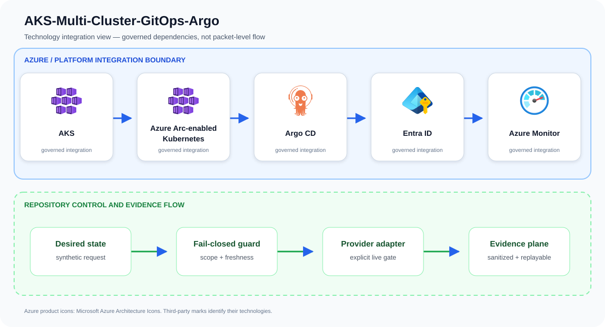
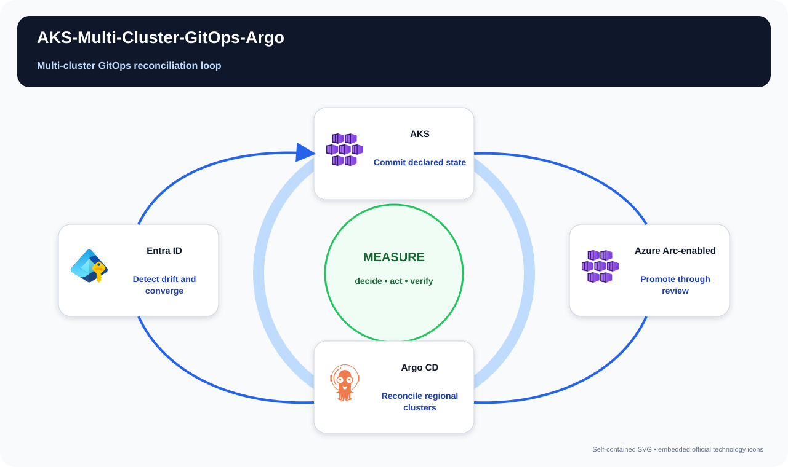

# AKS-Multi-Cluster-GitOps-Argo

Operate consistent policy and application state across regional AKS clusters through pull-based GitOps.

## Project metadata

The metadata below is derived from tracked source, manifests, and infrastructure
files. It describes what this repository includes; live-service integration remains
bounded by the documented deployment and validation limitations.

| Category | Included |
| --- | --- |
| Platforms | Microsoft Azure; GitHub Actions; Kubernetes |
| Services and stack | AKS; Azure Arc-enabled Kubernetes; Argo CD; Entra ID; Azure Monitor |
| Languages and formats | Python; Bicep; Bicep parameters; Bash; JSON; YAML |
| Delivery and IaC | Bicep + `.bicepparam`; GitHub Actions CI; Kubernetes/YAML manifests; Python validation/tests |

## Problem statement

A desired-state promotion request is validated before planning Argo CD and Arc synchronization across approved regional clusters with private access and deterministic evidence.

A production implementation can still fail even when every resource deploys successfully. The material risk is a cluster that appears healthy while administration, workload identity, tenant isolation, recovery, scaling, or egress differs from the reviewed design. The design therefore treats AKS, Azure Arc-enabled Kubernetes, Argo CD, and the surrounding identity and evidence controls as one reviewable system rather than unrelated configuration tasks.

## Example case study

### Situation

A global platform runs multiple AKS clusters whose policies and add-ons drift independently. This framework makes Git the reviewed source of truth and provides a consistent recovery path when a region or cluster diverges.

### Response

A platform team promotes one release to two regional clusters through Argo CD. One cluster drifts after an emergency edit; reconciliation identifies the difference and requires an approved Git change without exposing cluster credentials to the application repository.

The team first exercises the repository's synthetic approved and denied fixtures. An approved request must produce the same idempotent plan on replay; a stale, unscoped, public, or unapproved request must fail before an Azure adapter is allowed to run.

### Expected outcome

Stakeholders receive a decision package they can attach to a change record: requested scope, controls evaluated, the reason for approval or denial, and the explicit handoff to live integration. The example supports design review and incident rehearsal without pretending that a local test changed Azure.

## Architecture

A management plane registers private clusters through Azure Arc and Argo CD. Repository layers separate global baseline, region, environment, and application configuration; workload identity, signed artifacts, promotion gates, and observability secure reconciliation.

Primary services: `AKS`, `Azure Arc-enabled Kubernetes`, `Argo CD`, `Entra ID`, `Azure Monitor`.

This repository implements the first production-oriented vertical slice: a
fail-closed, adapter-neutral control plane that validates tenant scope,
freshness, approvals, secretless identity, private access, and the exact
project action before producing a deterministic execution plan. Azure adapters
consume that plan; they are deliberately outside the local simulator so local
tests cannot claim a live cloud change occurred.



The upper boundary names the principal services and technologies used by this repository. The lower boundary shows the implemented control flow: desired state is validated, provider action remains an explicit integration gate, and sanitized evidence is retained for review and deterministic replay.

## Best complementary diagram

**Recommended view: Multi-cluster GitOps reconciliation loop.** A control-loop view is the strongest complement because it shows how observed state becomes a bounded decision, an action, and measured feedback.



The view follows **Commit declared state → Promote through review → Reconcile regional clusters → Detect drift and converge**. Use it during design reviews, operational walkthroughs, and failure-mode discussions; use the logical architecture above when the question is which technologies integrate.

## Quickstart

Requirements: Python 3.11+ and Git. No Azure credentials are required.

```bash
./scripts/validate.sh
python3 src/control_plane.py --request examples/approved-request.json
```

The command emits canonical JSON with a stable idempotency key. The denied
fixture exits with status 2 and explains the failed invariants.

## Security boundaries

- Managed identity or workload identity only; embedded credentials are denied.
- Public network access and stale evidence are denied.
- Production and break-glass targets require explicit approval.
- The IaC entry point is opt-in and defaults to deploying nothing.
- Evidence output contains identifiers and decisions, never credential values.

## Verification and limitations

Local validation covers 13 tests, deterministic replay, JSON parsing, Python
compilation, ignore hygiene, and Bicep compilation when a compiler is present.
It does **not** prove Azure deployment, service licensing, quota, data-plane
permissions, provider/API availability, cloud failover, load, cost, or teardown.
See [`docs/test-matrix.md`](docs/test-matrix.md) and [`docs/runbook.md`](docs/runbook.md) before any integration trial.

## Community

See [`CONTRIBUTING.md`](CONTRIBUTING.md), [`SECURITY.md`](SECURITY.md), [`SUPPORT.md`](SUPPORT.md), and [`LICENSE`](LICENSE). The reference
is intentionally conservative and uses synthetic identifiers only.

## Repository guide

- [Architecture](docs/architecture.md)
- [Threat model](docs/threat-model.md)
- [Operations runbook](docs/runbook.md)
- [Test matrix](docs/test-matrix.md)
- [Cost model](docs/cost-model.md)
- [Security policy](SECURITY.md)
- [Contributing guide](CONTRIBUTING.md)
- [Support policy](SUPPORT.md)
- [Changelog](CHANGELOG.md)
- [License](LICENSE)

## Infrastructure inputs

Resource behavior and deploy-time values are intentionally separated:

- [Bicep template](infra/main.bicep) — Azure resources, modules, and security controls.
- [Bicep parameters](infra/main.bicepparam) — environment-specific names, regions, identities, and feature inputs.

Start with the parameter file's safe values, replace synthetic identifiers, and run an Azure what-if before deployment.

## Attribution

Azure product icons come from [Microsoft's official Azure Architecture Icons](https://learn.microsoft.com/azure/architecture/icons/). Open-source marks are sourced from [Simple Icons](https://simpleicons.org/) when shown; each mark identifies its respective technology.
